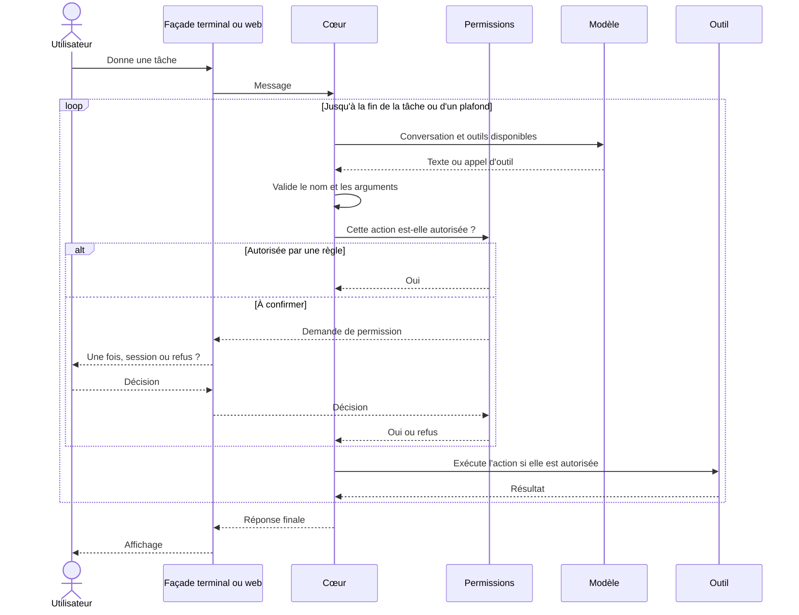
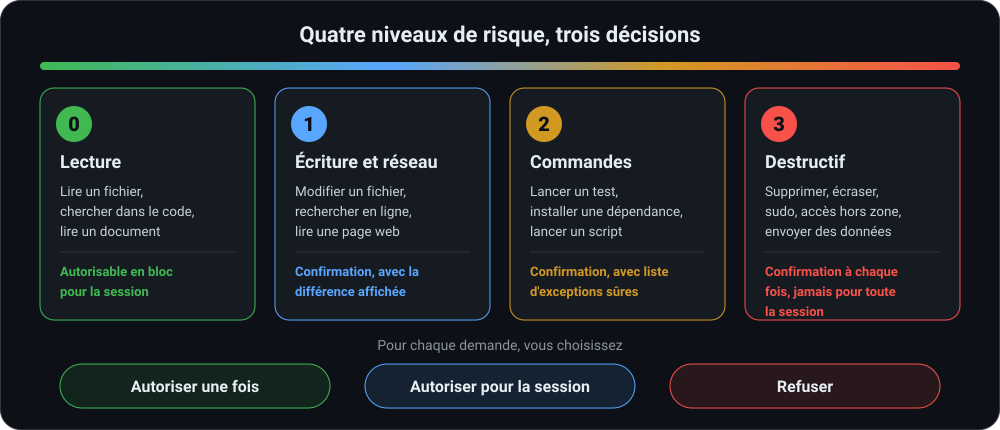

<div align="center">


<br>
<br>

### Un agent de code qui tourne chez vous, avec le modèle de votre choix

Un terminal et une interface web, un seul moteur.<br>
Ollama en local ou service distant : il suffit de changer l'adresse.

<br>


<br>

[Démarrage rapide](#démarrage-rapide) &nbsp;·&nbsp;
[Architecture](#architecture) &nbsp;·&nbsp;
[Permissions](#permissions) &nbsp;·&nbsp;
[Feuille de route](#feuille-de-route) &nbsp;·&nbsp;
[Contribuer](#contribuer)

</div>

<br>

> [!NOTE]
> LuluCode est en cours de développement, la version 0.1 est en préparation. Les commandes et les options décrites ici sont l'interface visée pour cette version, elles peuvent encore bouger. Voir la [feuille de route](#feuille-de-route).

## Pourquoi LuluCode

Les agents de code les plus connus sont pensés pour de gros modèles hébergés chez un fournisseur. LuluCode part d'un autre point de départ : votre machine, votre code, votre choix de modèle.

- **Vous gardez la main.** Chaque action de l'agent passe par un système de permissions. Rien n'est écrit, lancé ou supprimé sans qu'une règle ou vous-même l'ayez autorisé.
- **Il fonctionne aussi avec de petits modèles locaux.** Les appels d'outils sont validés avant exécution, les erreurs sont renvoyées au modèle pour qu'il se corrige, et un mode de secours existe pour les modèles qui ne gèrent pas les outils.
- **Il lit vos documents.** Grâce à [DocScan](https://github.com/VOTRE-COMPTE/docscan), un PDF, un fichier Word ou Excel, un scan ou une photo de téléphone arrive sous forme de Markdown compact, ce qui économise des tokens.
- **Un seul moteur.** Le terminal et l'interface web utilisent exactement le même cœur, donc le même comportement et les mêmes permissions.

## Fonctionnalités

<table>
  <tr>
    <td width="33%" valign="top">
      <h4>Tous les modèles</h4>
      Tout service qui parle le format de l'API OpenAI : Ollama, llama.cpp, ou un fournisseur distant. On passe de l'un à l'autre par un simple profil.
    </td>
    <td width="33%" valign="top">
      <h4>Permissions par niveau</h4>
      Quatre niveaux de risque, trois décisions (une fois, session, refus), trois modes (normal, strict, lecture seule).
    </td>
    <td width="33%" valign="top">
      <h4>Deux interfaces</h4>
      Un terminal interactif et une interface web locale, avec historique, différences de fichiers côte à côte et boutons d'autorisation.
    </td>
  </tr>
  <tr>
    <td width="33%" valign="top">
      <h4>Outils pour le code</h4>
      Lire, créer et modifier des fichiers avec affichage des différences, lancer des commandes, chercher dans le code et sur le web.
    </td>
    <td width="33%" valign="top">
      <h4>Documents avec DocScan</h4>
      PDF, Office, scans et photos convertis en Markdown compact avant lecture, pour garder un contexte léger.
    </td>
    <td width="33%" valign="top">
      <h4>Journal complet</h4>
      Chaque action, la décision prise et son résultat sont enregistrés. Les clés et secrets sont masqués.
    </td>
  </tr>
</table>

## Démarrage rapide

**Prérequis**

- Python 3.11 ou plus récent
- Un modèle : soit [Ollama](https://ollama.com) installé sur votre machine, soit une clé d'accès à un service compatible avec le format OpenAI
- Node.js 20 ou plus récent, seulement si vous voulez modifier l'interface web (pas nécessaire pour l'utiliser)

**Installation**

```bash
pipx install lulucode
```

**Premier lancement avec un modèle local**

```bash
# 1. Télécharger un modèle avec Ollama
ollama pull nom-du-modele-local

# 2. Créer le fichier de configuration
lulucode config init

# 3. Se placer dans un projet et lancer l'agent
cd ~/mon-projet
lulucode
```

Pour l'interface web, une seule commande, puis ouvrez l'adresse affichée :

```bash
lulucode web
```

L'interface web n'écoute que sur votre machine, et un jeton d'accès est généré à chaque lancement.

<div align="center">

</div>

### Commandes utiles

| Commande | Effet |
| --- | --- |
| `lulucode` | Démarre une session dans le terminal, dans le dossier courant |
| `lulucode web` | Démarre l'interface web locale |
| `lulucode --profil distant` | Utilise un autre profil de modèle pour cette session |
| `lulucode --mode strict` | Demande une confirmation pour toute action, lectures comprises |
| `lulucode --mode lecture-seule` | Lecture et plan uniquement, aucune écriture ni commande |

Dans une session, quelques commandes commencent par une barre oblique :

| Commande | Effet |
| --- | --- |
| `/profil` | Affiche ou change le profil de modèle |
| `/mode` | Affiche ou change le mode de permission |
| `/journal` | Affiche les dernières actions et leurs décisions |
| `/aide` | Liste toutes les commandes |

## Configurer un modèle

Le fichier de configuration se trouve dans `~/.config/lulucode/config.toml`. Chaque profil décrit un modèle. Passer du local au distant ne demande aucun autre changement.

```toml
[profils.local]
base_url = "http://localhost:11434/v1"
model = "nom-du-modele-local"
api_key = "ollama"
contexte = 8192
outils_natifs = true          # mettre false si le modèle ne gère pas les outils

[profils.distant]
base_url = "https://adresse-du-service/v1"
model = "nom-du-modele-distant"
api_key_env = "LULUCODE_CLE_DISTANTE"
contexte = 128000

[general]
profil_par_defaut = "local"
plafond_etapes = 40           # nombre maximal d'étapes par tâche
plafond_tokens = 200000       # nombre maximal de tokens par tâche
```

Les clés distantes se lisent dans une variable d'environnement. Elles ne sont jamais écrites dans le fichier de configuration, ni dans le journal.

| Variable | Rôle |
| --- | --- |
| `LULUCODE_CONFIG` | Chemin d'un fichier de configuration différent de celui par défaut |
| `LULUCODE_PROFIL` | Profil de modèle à utiliser au lieu du profil par défaut |
| `LULUCODE_CLE_DISTANTE` | Exemple de variable contenant la clé du profil `distant` |

## Architecture

LuluCode repose sur un cœur unique et deux façades qui ne font qu'afficher des événements et renvoyer les réponses de l'utilisateur.

<div align="center">

</div>

Le cœur est une bibliothèque Python sans interface. Il ne sait pas s'il est piloté depuis un terminal ou un navigateur. Une demande de permission est un événement comme un autre, dont la réponse revient par le même canal : c'est ce qui garantit que les deux façades appliquent exactement les mêmes règles.

### La boucle d'agent



Quand une action est refusée, le refus est renvoyé au modèle, qui doit proposer autre chose.

## Outils

| Outil | Rôle | Niveau de risque |
| --- | --- | :---: |
| Lire un fichier, lister un dossier | Lecture dans la zone de travail | 0 |
| Rechercher dans le code | Par nom de fichier et par contenu | 0 |
| Lire un document avec DocScan | PDF, Office, scans et photos en Markdown compact | 0 |
| Mémoire de projet | Lit `AGENTS.md` (ou `CLAUDE.md` à défaut) et les notes versionnées | 0 |
| Créer ou modifier un fichier | Écriture, avec la différence affichée avant application | 1 |
| Rechercher en ligne, lire une page web | Requête réseau sortante | 1 |
| Lancer une commande | Terminal, durée limitée, sortie capturée | 2 |
| Supprimer, écraser, administrer, sortir de la zone | Actions destructrices ou sensibles | 3 |

## Permissions

C'est la pièce centrale du projet : aucune action n'est exécutée sans qu'une règle l'ait autorisée.

<div align="center">

</div>

### Modes de fonctionnement

| Mode | Comportement | Quand l'utiliser |
| --- | --- | --- |
| Normal | Les règles de niveau décrites ci-dessus | Dans vos projets habituels |
| Strict | Tout demande confirmation, lectures comprises | Dossier inconnu, modèle peu fiable |
| Lecture seule | L'agent lit et propose un plan, sans écrire ni lancer de commande | Pour comprendre un projet sans rien risquer |

### Règles de sécurité

- **Zone de travail.** L'agent reste dans le dossier du projet. Les chemins sont résolus en chemins réels, liens symboliques compris, avant chaque vérification. Tout accès extérieur est de niveau 3.
- **Commandes.** Une commande connue et sans danger peut être autorisée par préfixe. Une commande inconnue ou composée (enchaînements, redirections, substitutions) est traitée au niveau supérieur, car analyser un shell de façon sûre est difficile. Une liste de motifs dangereux, comme une suppression récursive, un push forcé ou l'exécution d'un script téléchargé, reste toujours de niveau 3.
- **Injection d'instructions.** Le contenu d'une page web ou d'un document est traité comme des données, jamais comme des ordres. Toute action sensible qui en découle demande une confirmation, avec l'origine de l'instruction indiquée.
- **Secrets.** Les clés et variables sensibles ne sont jamais envoyées au modèle, et sont masquées dans le journal et dans la sortie des commandes.
- **Plafonds.** Nombre d'étapes et de tokens par tâche, avec affichage de la consommation.

### Personnaliser les règles

Un fichier par projet permet d'ajuster les règles, par exemple pour autoriser sans confirmation les commandes dont vous êtes sûr.

```toml
# .lulucode/permissions.toml

[permissions]
zone_de_travail = "."
commandes_sures = ["git status", "git diff", "pytest", "ruff check"]
```

Les actions de niveau 3 ne peuvent jamais être ajoutées à cette liste.

## Fiabilité avec les petits modèles locaux

Les petits modèles appellent parfois mal les outils ou produisent un format invalide. LuluCode prévoit plusieurs garde-fous :

1. **Validation avant exécution.** Le nom de l'outil et ses arguments sont vérifiés contre un schéma. Un appel invalide n'est jamais exécuté.
2. **Correction guidée.** L'erreur est renvoyée au modèle avec un message court et précis, avec au plus deux nouvelles tentatives par appel.
3. **Profil d'outils réduit.** Pour un petit modèle, on n'expose que les outils essentiels, parce qu'une longue liste augmente les erreurs.
4. **Mode de secours.** Si le modèle ne gère pas nativement les appels d'outils, l'agent lui demande un bloc structuré dans le texte, qu'il analyse lui-même.
5. **Contexte allégé.** Les longues conversations sont résumées automatiquement et les documents sont lus en Markdown compact.

<details>
<summary><b>Résultats des tests de modèles</b></summary>

<br>

Plusieurs modèles sont comparés sur un même jeu d'environ 20 tâches types : lire un fichier, modifier une fonction, lancer des tests, chercher dans le code, lire un PDF. Les résultats seront publiés ici avant la version 0.1, avec le script pour les reproduire.

| Modèle | Appels d'outils valides | Tâches réussies | Remarques |
| --- | :---: | :---: | --- |
| Modèle orienté code, local | à venir | à venir | |
| Modèle généraliste, local | à venir | à venir | |
| Modèle distant de référence | à venir | à venir | |

</details>

## Lire des documents avec DocScan

Quand [DocScan](https://github.com/VOTRE-COMPTE/docscan) est installé, LuluCode l'utilise automatiquement pour tout fichier qui n'est pas du texte brut. Le document est converti en Markdown compact avant d'être lu, ce qui réduit fortement le nombre de tokens envoyés au modèle.

```bash
pipx install docscan
```

DocScan est un outil optionnel, appelé par sa ligne de commande. Sans lui, LuluCode fonctionne normalement pour tout le reste.

## Structure du dépôt

```
lulucode/
  src/lulucode/
    core/           boucle d'agent, contexte, résumé des longues conversations
    model/          client au format OpenAI, profils, validation des appels d'outils
    tools/          fichiers, commandes, recherche de code, web, docscan
    permissions/    niveaux de risque, règles, décisions mémorisées, journal
    cli/            façade terminal
    server/         façade web (API et flux d'événements)
  web/              interface React
  tests/            tests unitaires et évaluations d'appels d'outils par modèle
  docs/             guides en français et en anglais
  assets/           images du README
  AGENTS.md  README.md  LICENSE  CONTRIBUTING.md  SECURITY.md  CODE_OF_CONDUCT.md
```

## Sécurité

> [!WARNING]
> Un agent qui lance des commandes sur votre machine reste un outil puissant. Lisez les demandes de confirmation avant d'accepter, surtout pour les niveaux 2 et 3.

Quelques bonnes pratiques :

- Commencez en mode `strict` ou `lecture-seule` sur un projet que vous ne connaissez pas.
- N'autorisez pour la session que des actions de lecture, et des commandes précises plutôt que larges.
- Pour du code non fiable, lancez LuluCode dans un conteneur ou une machine virtuelle.
- Ne placez jamais une clé dans un fichier du projet : utilisez une variable d'environnement.

Pour signaler une faille, ne créez pas d'issue publique. Suivez les instructions de [SECURITY.md](SECURITY.md).

## Feuille de route

**Version 0.1**

- [ ] Boucle d'agent et contrat d'événements
- [ ] Client au format OpenAI avec profils local et distant
- [ ] Outils de fichiers, de recherche de code et de commandes
- [ ] Permissions complètes : niveaux, modes, autorisation de session, journal
- [ ] Façade terminal
- [ ] Façade web
- [ ] Outil DocScan, recherche en ligne et lecture de pages web
- [ ] Validation des appels d'outils, correction guidée, mode de secours
- [ ] Résultats des tests sur plusieurs modèles publiés
- [ ] Documentation en français et en anglais, paquet PyPI

**Ensuite**

- [ ] Prise en charge de MCP pour brancher des outils externes
- [ ] Sous-agents pour les tâches longues
- [ ] Système d'extensions
- [ ] Intégration à un éditeur de code

## Contribuer

Les contributions sont les bienvenues, que ce soit du code, de la documentation, des tests sur de nouveaux modèles ou des retours d'usage. Regardez les issues marquées `bon premier ticket`.

```bash
git clone https://github.com/VOTRE-COMPTE/lulucode.git
cd lulucode

python -m venv .venv && source .venv/bin/activate
pip install -e ".[dev]"
pytest

# Interface web
cd web && npm install && npm run dev
```

1. Créez une branche : `git checkout -b feature/ma-fonctionnalite`
2. Ajoutez des tests pour ce que vous modifiez.
3. Committez avec la convention ci-dessous.
4. Ouvrez une Pull Request en décrivant le problème résolu.

| Préfixe | Usage |
| --- | --- |
| `feat:` | Nouvelle fonctionnalité |
| `fix:` | Correction de bug |
| `docs:` | Documentation uniquement |
| `refactor:` | Réécriture sans changement de comportement |
| `test:` | Ajout ou modification de tests |
| `chore:` | Maintenance, dépendances, configuration |

Tout changement qui touche aux permissions doit s'accompagner de tests automatiques : aucune action de niveau 3 ne doit pouvoir s'exécuter sans confirmation. Merci de lire aussi le [code de conduite](CODE_OF_CONDUCT.md) et le guide [CONTRIBUTING.md](CONTRIBUTING.md).

## Dans le même paysage

LuluCode n'est pas le premier agent de code open source, et il ne cherche pas à remplacer les autres. [OpenCode](https://opencode.ai), [Aider](https://aider.chat), [Goose](https://block.github.io/goose/) et [Cline](https://cline.bot) sont d'excellents projets, qui ont inspiré plusieurs idées ici. Ce qui distingue LuluCode : la lecture de documents par DocScan, l'attention portée aux petits modèles locaux, et le même moteur derrière le terminal et le web.

## Licence

LuluCode est distribué sous licence [Apache 2.0](LICENSE).

Copyright 2026 Ludel Topanou et les contributeurs de LuluCode.

<br>

<div align="center">

Si LuluCode vous est utile, une étoile sur GitHub aide le projet à être découvert.

</div>
